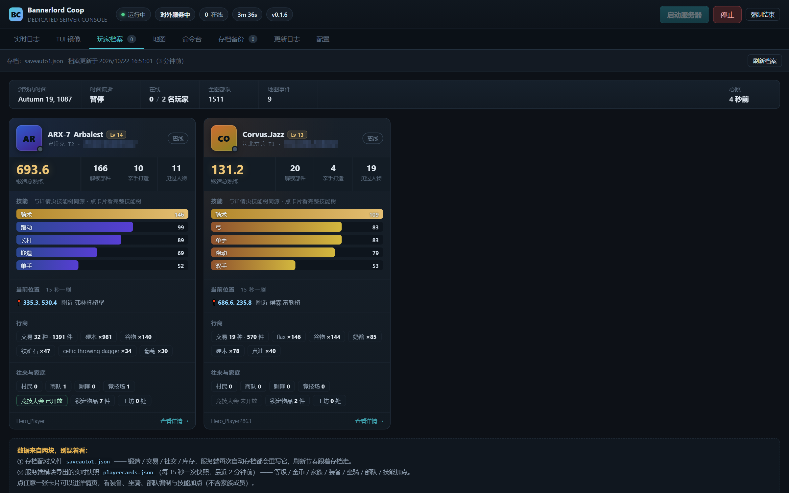
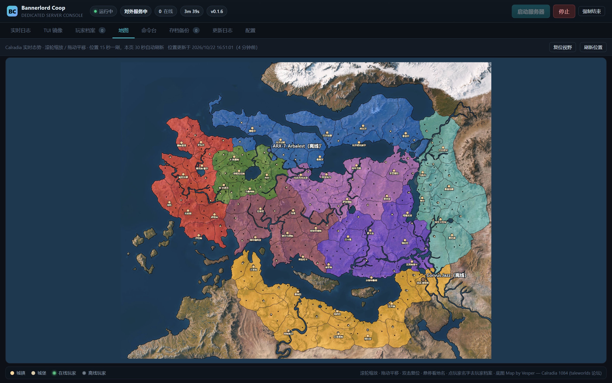
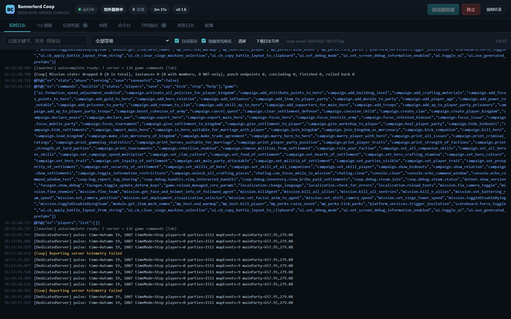
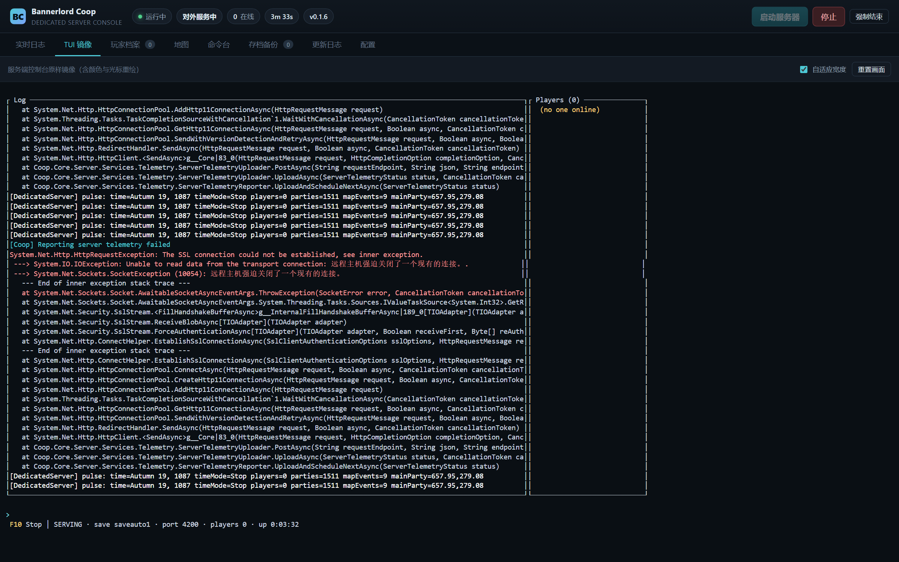
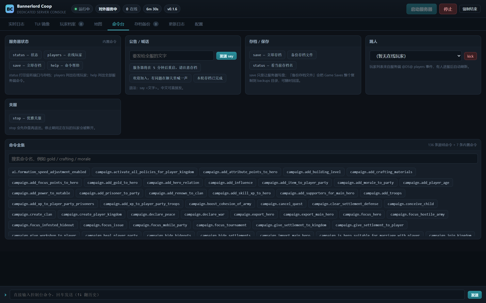
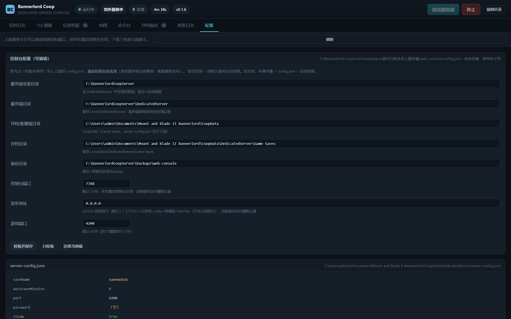

# Bannerlord Coop 服务器 Web 控制台


[Bannerlord Coop](https://github.com/Bannerlord-Coop-Team/BannerlordCoop) 专用服务器的浏览器运维面板：
实时日志、TUI 镜像、玩家档案（装备 / 部队 / 技能）、全图玩家位置、起停服务器、存档备份、命令台、更新日志。

零前端框架、零构建步骤，唯一外部依赖是 `node-pty`。





## 快速开始

**用现成的包**：下载 [Releases](../../releases) 里的 zip，解压 → 双击 `start-console.bat` → 浏览器打开
**http://127.0.0.1:7788**。zip 里已经带了 Node 运行时，不需要安装任何东西。

**从源码跑**（需要 Node 18+）：

```bat
npm install
node server.js                :: 监听 0.0.0.0:7788（所有网卡）
node server.js --port 7790    :: 换个端口
node server.js --local        :: 只本机 127.0.0.1
```

默认就是 `0.0.0.0`，**谁连得上这台机器谁就能打开面板**，不按来源 IP 过滤。

首次启动后到「配置」标签填两个路径（服务端安装目录 / 存档目录），保存并重启控制台。
路径填错卡片下面会标红，不用猜。

> ⚠️ **服务端跑在控制台的伪终端里 —— 关掉控制台窗口，服务器会一起停。**
> 想长期挂机不占浏览器，就照旧双击 `start-server.bat`，控制台仍可打开当只读面板
> （顶栏会标"外部实例"，能看日志、能强制结束，但下发不了命令）。

## 界面

| | |
|---|---|
|  |  |
| 实时日志（等级/关键字过滤、一键下载） | TUI 镜像（方块界面原样还原） |
|  |  |
| 玩家档案 | 全图玩家位置 |
|  |  |
| 命令台（136 条命令全集） | 配置页（可编辑 + 路径校验） |

完整使用手册：[`docs/manual.html`](docs/manual.html)（12 章，A4 排版，可直接打印成 PDF）。

---

## 一、功能对照

| 标签页 | 能干什么 |
|---|---|
| 实时日志 | 跟随最新 `coop-server-*.log`，按等级/关键字过滤（支持 `-排除词`），一键下载日志文件 |
| TUI 镜像 | 把服务端那个方块界面的原始 ANSI 输出原样画在浏览器里（含颜色、边框、光标重绘） |
| 玩家档案 | 每个玩家一张卡（魔兽世界 Armory 那种）：头像块、家族、Steam 主页、等级、锻造总熟练、技能进度条（与详情页技能树同源）、当前位置行（坐标 + 附近地标）、交易与社交数据；顶栏是游戏内时间/时间流逝/全图部队数 |
| 地图 | 独立菜单，整屏 Calradia：**真实游戏地图做底图（图上英文已全部抹除，地名由页面用中文标注，悬停看中英文，城堡名放大后才显示）**，可滚轮缩放、拖动平移、双击/按钮复位视野 + **所有玩家**的彩色位置标记（在线亮色/离线灰色，悬停看坐标/兵力/附近地标，点名字跳玩家档案）。30 秒自动刷新，手动「刷新位置」立即重拉 |
| 玩家详情 | 点卡片进去：等级/金币/生命、**战斗与平民两套装备（含头盔、马、马具）**、身份与家族、**部队编制（总兵力/兵种/伤员/俘虏/士气 + 按等级构成条 + 兵种明细）**、**技能加点（熟练度条 + 专注点）与属性点**。刻意不含家族成员 |
| 命令台 | 内置命令按钮（status/players/save/help）、`say` 公告、`kick` 踢人、`stop` 关服、136 条命令全集搜索；底部可直接敲命令，↑↓ 翻历史 |
| 存档备份 | 一键备份（可选"先让服务器 save 再打包"）、恢复、删除；恢复前自动把当前存档另存一份 |
| 更新日志 | 从 GitHub Releases 抓取并渲染 Markdown，自动标记"当前运行版本" |
| 配置 | 只读展示 `server-config.json`、`mod-config.json` 的关键项与所有路径 |

顶栏常驻：运行状态、阶段（启动中/载入存档/对外服务中）、在线人数、运行时长、模组版本，以及启动 / 停止 / 强制结束。

---

## 二、目录结构

```
web-console/
├─ server.js                  HTTP + SSE + 路由（零框架）
├─ start-console.bat          启动控制台（默认 0.0.0.0:7788，所有网卡都能进）
├─ open-firewall.bat          管理员放行 TCP 7788 / UDP 4200（换机才需要）
├─ node.exe                   仅发布包里有（绿色版运行时，源码库里没有）
├─ INSTALL.txt                仅发布包里有（给玩家的安装说明）
├─ QUICKSTART.txt             仅发布包里有（一页速查）
├─ config.json                本机配置（自己生成，可不存在；node lib/config.js --init）
├─ config.example.json        配置示例（带注释，分发给别人时看这个）
├─ lib/
│  ├─ config.js               路径/端口解析：环境变量 > config.json > 自动探测，含自检
│  ├─ console-config.js       配置页的后端：可编辑字段表、校验、安全写入 config.json
│  ├─ server-process.js       PTY 里的服务端进程：起停、状态、命令下发
│  ├─ log-tailer.js           日志文件增量读取（UTF-8/GBK 自适应、噪音分级）
│  ├─ saves.js                备份 / 恢复 / 列表 / 删除
│  ├─ players.js              玩家档案：解析存档配对文件，聚合每个 hero 的锻造/交易/社交
│  ├─ playercards.js          玩家详情：读服务端模块导出的 playercards.json，整理成装备/部队/技能
│  ├─ l10n.js                 官方中文包解码（UTF-16BE/LE/UTF-8），按字符串 id 查译文
│  ├─ map.js                  解析 settlements.xml 出 Calradia 底图（城镇/城堡坐标 + 中文名）
│  ├─ procs.js                端口占用与 PID 侦测、进程树强杀
│  └─ jsonc.js                带注释 JSON 解析
├─ public/
│  ├─ index.html              单页八个标签
│  ├─ app.js                  全部前端逻辑
│  ├─ term.js                 ANSI 屏幕缓冲区（TUI 镜像核心）
│  ├─ style.css               深色 dashboard
│  └─ img/
│     └─ calradia.jpg         真实底图（Map by Vesper「Calradia 1084」，已标定）
├─ data/
│  ├─ commands.json           7 条内置 + 136 条游戏命令（服务端启动时会自动刷新）
│  └─ changelog.json          GitHub Releases 缓存
├─ preview/                   本地调试用的静态快照（生成物，不入库）
│  ├─ players-preview.html         玩家档案名册的静态快照（单文件，双击就能看，不用起服务）
│  ├─ players-detail-preview.html  玩家详情页的静态快照（同上）
│  └─ map-preview.html             「地图」菜单的静态快照（同上）
└─ tools/
   ├─ fetch-changelog.js      抓更新日志
   ├─ build-release.js        打包：生成发布目录 + 内置 node.exe + 打 zip；也生成可推送的源码目录
   ├─ test-parser.js          状态解析回归测试
   ├─ test-term.js            TUI 模拟器回归测试（无浏览器）
   ├─ test-players.js         玩家档案数据层测试（直接吃真实存档）
   ├─ test-players-view.js    玩家档案渲染测试（假 DOM 里跑真实 app.js）
   ├─ test-playercards.js     玩家详情数据层测试（HeroId 归一、槽位判定、部队汇总）
   ├─ test-detail-view.js     玩家详情渲染测试（假 DOM）
   ├─ test-map-view.js        地图菜单渲染测试（假 DOM；底图/翻转/玩家标记/在线离线配色/悬停/图例/缩放平移复位）
   ├─ test-config.js          配置层：环境变量>config.json>探测的优先级、路径缺失提示、--init
   ├─ test-console-config.js  配置可编辑：空值删键/越界拒绝/坏文件不覆盖/保留无关键/环境变量锁定
   ├─ test-config-page.js     配置页表单渲染测试（假 DOM；字段顺序/回填/锁定禁用/致命红条）
   ├─ calibrate-step1~4.js    底图标定工具（裁图目检 / 白圆检测 / 投影迭代 / 最小二乘，产出 calibration.json）
   ├─ erase-labels.js         抹掉底图上的英文标注（白掩膜+连通域+矩形补刀+BFS 修复）
   ├─ crop.js                 裁图目检小工具（erase-labels 调参用）
   ├─ make-players-preview.js 生成上面那份静态快照
   ├─ lib/fake-dom.js         极简假 DOM，让 Node 能跑前端渲染函数
   └─ ptyprobe.js             PTY 探针，换机时先跑它
```

---

## 三、配置与分发（换机 / 给别人用）

路径、端口全部可配，**代码里没有写死盘符**：控制台自己算位置，服务端目录自动往上找。
优先级：**环境变量 > `config.json` > 命令行参数（`--host` / `--port`）> 默认值**
（`--port` / `--host` 因为点了具体值，优先级比文件高，细节见「十、改 .bat 时的硬性规矩」）。

> 端口和监听地址以前是 `start-console.bat` 用 `set COOP_CONSOLE_*` 传的，等于把这两项钉死在
> 优先级最高处——页面改了不生效。现在 bat 改用命令行参数，只当兜底默认，**`config.json` 说了算**。
> 详见「十、改 .bat 时的硬性规矩」。

### 三个动作

```bat
node lib/config.js            :: 打印解析结果：每一项路径 + 存在与否 + 该怎么改
node lib/config.js --init     :: 按当前探测结果生成 config.json（已存在不覆盖）
```

启动控制台时也会做同样的自检，路径不对会直接打在启动日志里（带修改建议），
不用等点「启动」才报错。页面的 `/api/config` 接口同样返回 `configFile` / `issues`。

### 在页面上直接改（不用碰文件）

「配置」标签页最上面那张卡片就是可编辑表单，8 个键一人一行，改完点「校验并保存」：

- **只校验**：`POST /api/console-config` 带 `dryRun: true`，只回校验结果，不落盘
- **校验并保存**：校验通过才写 `config.json`（带注释头），校验不过**一个字都不写**
- **还原当前值**：把输入框恢复成磁盘上正在生效的值
- 字段留空 = 从文件里删掉这一项，回退到默认/自动探测（不是写空字符串）
- 文件里**不属于这 8 个键的其他键原样保留**，所以手写的注释性配置不会被吞
- 某项被环境变量锁住时，输入框置灰打标，并提示「改了也不生效」；强行保存仍会写文件，
  但返回里带 `lockedIgnored` 告诉你是哪几项被环境变量压住了

> 存完必须**重启控制台**才生效 —— `lib/config.js` 在 `require` 的瞬间就把值固化成常量了。
> 重启会连带停掉 PTY 里的游戏服务端，起来后记得再点一次「启动」。

校验规则：端口 `1~65535` 整数；`root`/`serverDir` 指向的 `BannerlordCoopServer.exe` 不存在算**致命**；
`coopData` 不存在也算致命；`savesDir`/`backupDir` 不存在只算警告（服务端跑一次/第一次备份就会出现）。

### config.json 字段

| 字段 | 说明 | 默认 |
|---|---|---|
| `root` | 服务端安装目录（含 `DedicatedServer` 子目录的那层） | 从控制台目录往上找 5 层 |
| `serverDir` | 服务端目录本身；给了就不用 `root` | `root\DedicatedServer`（若 `root` 本身就是服务端目录则不拼） |
| `coopData` | 存档/配置根目录（`server-config.json`、`Game Saves` 都在这下面） | `%USERPROFILE%\Documents\Mount and Blade II Bannerlord\CoopData` |
| `savesDir` / `dsLogsDir` / `backupDir` | 单独覆盖存档、日志、备份目录 | 都从 `coopData` / 控制台目录推算 |
| `port` / `host` | 监听端口与地址（`0.0.0.0` / `127.0.0.1` / `auto`） | `7788` / `0.0.0.0` |
| `gamePort` | 游戏端口（防火墙要放行 UDP） | `4200` |

示例见 `config.example.json`（带注释，`lib/jsonc` 解析，允许 `//` 和尾逗号）。

### 分发给别人的最短路径

1. 把整个 `web-console` 目录拷过去（`node_modules` 要带上，`node-pty` 是原生的，换机最好重装）
2. `node lib/config.js` —— 看哪一项 ✗，照着提示改
3. 大概率只需要改 `coopData`（对方 Windows 用户名不同）
4. 双击 `start-console.bat` —— 默认全网卡监听，本机和别的机器都能开

> 备份目录默认放控制台自己的 `backups\`；若检测到老布局
> `root\backups\web-console` 存在则沿用，避免升级后找不到历史备份。

---

## 四、三个必须知道的坑（都踩过）

### 1. 不能用 `child_process.spawn` 抓输出，必须给真 PTY

服务端的 TUI 和"stdin/stdout 被重定向"互斥。用 pipe 抓输出，launcher 会自动切到 `--no-tui`，
而这个模式在本机**永远到不了 SERVING**：日志停在 ~1228 字节、UDP 4200 端口却已经绑定，
极容易误判成"服务器起来了但客户端连不上"。

所以 `node-pty` + ConPTY 是硬需求，不是偏好。实测：launcher → dotnet starter 全程正常，
约 **58–60 秒**到 SERVING。

> 判断服务器是否真的起来，**只认日志里的 `[DedicatedServer] SERVING —`**，不要看端口。

### 2. 启动横幅里也有 "SERVING"，直接 includes 会第 0 秒就误判

```
[launcher] ready when you see: [DedicatedServer] SERVING   ·   'help' lists commands   ·   F10 stops
```

只要 `includes('SERVING')` 就会在启动后 800ms 内误报就绪。正确判据是同时要求：

- 行内出现 `[DedicatedServer] SERVING`，
- 且**不是** `[launcher]` 横幅行（不含 `ready when you see`）。

状态权威来源是**日志文件**里的 `@DS@{"ev":"state","phase":"..."}` 事件，PTY 流只作兜底。
`tools/test-parser.js` 专门锁死这两条。

### 3. TUI 里的非 ASCII 是二次编码的乱码

launcher 把 UTF-8 字节当 ANSI 写进控制台，控制台再按 UTF-8 编出来，于是：

```
真实 "—"(E2 80 94)  →  TUI 里变成 "—"(C3 A2 E2 82 AC E2 80 9D)
```

`term.js` 里的 `repairMojibake()` 用 cp1252 逆映射把这段可逆变换倒回去；只在命中可疑字符
且回解为合法 UTF-8 时才动手，正常中文与制表符不受影响。

---

## 五、状态是怎么算出来的

| 字段 | 来源 |
|---|---|
| `state` | 自己起的进程（starting/running/stopping/stopped）；外部实例另标 `external` |
| `phase` | 日志里的 `@DS@{"ev":"state","phase":boot\|loading\|serving}` |
| `players` | 日志里的 `@DS@{"ev":"players","list":[...]}` |
| `version` | 日志里的 `BannerlordCoop build 0.1.6+5f4d63c` |
| `world` | 日志里的 `pulse: time=Autumn 19, 1087 timeMode=Stop players=0 parties=1511 …`（约 14 秒一条） |
| 端口占用 | `netstat -ano -p UDP` + `tasklist`，缓存 2.5 秒 |

外部启动的实例（用 `start-server.bat` 双击开的）控制台接手不了 TUI，会在顶栏标红"外部实例"，
此时仍可看日志、可"强制结束"，但不能下发命令。

---

## 六、HTTP 接口

下行用 SSE，上行用 fetch。没有 WebSocket。
对外监听时接口默认不校验口令。若启动前设了 `COOP_CONSOLE_TOKEN`，则所有接口都要求：
`?token=`、`Cookie: coop_console_token=…` 或 `X-Console-Token` 头，三者任一即可。

| 方法 | 路径 | 说明 |
|---|---|---|
| GET | `/api/status` | 状态快照 |
| POST | `/api/start` | 启动（端口被占会 409） |
| POST | `/api/stop` | 优雅停止：发 `stop`，最多等 45 秒后强杀 |
| POST | `/api/kill` | 强杀进程树（含外部实例） |
| POST | `/api/command` | `{cmd}` 或 `{cmds:[...], delay}` 下发控制台命令 |
| GET | `/api/events` | SSE：`hello` / `state` / `log` / `console` / `logfile` / `notice` / `commands` |
| GET | `/api/tui` | SSE：`seed`（最近 200KB 屏幕）+ `tui`（base64 原始块，120ms 合并） |
| GET | `/api/logs/history?lines=N` | 内存里最近 N 行 |
| GET | `/api/logs/files` | 日志文件列表 |
| GET | `/api/logs/download?file=` | 下载日志 |
| GET | `/api/saves` | 当前存档 + 备份列表 + 占用 |
| POST | `/api/saves/backup` | `{note, triggerSave}` |
| POST | `/api/saves/restore` | `{id}`，运行中会 409 |
| DELETE | `/api/saves/:id` | 删除备份 |
| GET | `/api/commands` | 命令表 |
| GET | `/api/players` | 玩家档案：存档配对文件 + 在线列表 + 世界心跳；每个玩家带 `detail`（装备/坐骑/部队/技能），见第十一节 |
| GET | `/api/perks` | 技能树目录：全部 perk 按技能分组、按需求熟练度分档，说明已中文化并带上具体数值。数据在 `lib/playercards.js`，与 `/api/players` 的 `detail` 同源 |
| GET | `/api/map` | Calradia 底图：城镇/城堡坐标（120 个，含中文名），来自 `settlements.xml`（mtime 缓存）。「地图」菜单画整屏态势图、名册卡片算「附近地标」都用它 |
| GET | `/api/changelog` | 更新日志缓存 |
| POST | `/api/changelog/refresh` | 重新抓取 GitHub Releases |
| GET | `/api/config` | 两份配置 + 路径（只读，游戏侧 + 控制台自身路径） |
| GET | `/api/console-config` | 控制台配置的可编辑视图：8 个字段定义 + 当前生效值 + `envLocked` + `issues` + `requiresRestart` |
| POST | `/api/console-config` | `{values}` 校验并写 `config.json`；`{dryRun:true, values}` 只校验不落盘。校验不过返回 **400** + `issues` + `error` 摘要 |

默认监听 `0.0.0.0`，也就是**这块机器上的每一张网卡都听**——回环、局域网、ZeroTier、公网网卡一视同仁，
不做任何来源 IP 过滤。谁能连上这台机器的 7788 端口，谁就能打开面板。双击 `start-console.bat`
就是这个行为，没有第二个开关要开。

启动窗口会打印几行可直接复制的地址，形如：

```
本机     : http://127.0.0.1:7788/
局域网   : http://<本机IP>:7788/
ZeroTier : http://<本机IP>:7788/
```

> `0.0.0.0` 是**监听地址**，不是你能在浏览器里敲的地址——浏览器要敲具体那张网卡的 IP，
> 启动窗口已经替你列好了。`http://0.0.0.0:7788` 只有部分系统能打开，别拿它发给别人。

**默认无口令**，这套东西跑在 ZeroTier / 内网里，都是自己人，直接敲地址就能进。
要精确指定只听哪几张网卡（比如只放 ZeroTier、不放公网那张），**推荐直接在「配置」页改**
（写进 `config.json`，重启生效）；临时试一次也可以用环境变量：

```bat
set COOP_CONSOLE_HOST=127.0.0.1,192.168.1.10
node server.js
```

`host` 的三种写法：

| 值 | 含义 |
|---|---|
| `0.0.0.0`（默认） | 全网卡，不做来源过滤 |
| `127.0.0.1` | 只本机 |
| `auto` | 只监听回环 + 私有网段（`10.x` / `172.16–31.x` / `192.168.x` / `100.64–127.x`），公网网卡不放 |
| `127.0.0.1,192.168.1.10` | 逗号分隔，精确指定只听这几个地址 |

**换端口**（`start-console.bat` 的唯一参数就是端口）：

```bat
start-console.bat 7790
```

> 端口只是**兜底默认**：`config.json` 里写了 `port` 就以文件为准。
> 想让端口固定下来，去「配置」页填一次保存，之后双击 bat 都用那个端口。

用途很具体：主控制台正在跑游戏服务端时，要开第二个面板看日志/玩家档案又不能动它，
就用另一个端口起一个**只读实例**——它不持有游戏进程，顶栏会标"外部实例"，
**别在那个窗口点「强制结束」，那会把真正在跑的服务端杀掉**。

> ⚠️ 无口令 + 全网卡监听意味着**任何能连上这台机器的人打开地址就能起停服务器、恢复存档、删备份**。
> 自己人的网络无所谓；哪天要放到不受信任的环境，启动前设一个口令即可：`set COOP_CONSOLE_TOKEN=你的口令`。
> 开启后支持 `?token=` / `Cookie: coop_console_token=…` / `X-Console-Token` 头三种带法，
> 地址栏带一次 token 会写入一年期 Cookie，之后不用再拼。更稳妥的做法是把 `host` 收成 `auto`
> 或写死内网地址，别让公网网卡暴露出去。

> 若换一台**开着防火墙**的机器，还要放行 TCP 7788：以管理员身份运行 `open-firewall.bat`
> （它同时会放行游戏用的 UDP 4200）。当前这台机器三个防火墙配置文件都是关闭状态，无需放行。

---

## 七、备份策略

- 位置：`F:\BannerlordCoopServer\backups\web-console\<时间戳>_<类型>\`
- 内容：`Game Saves` 下所有 `.sav` / `.json` + `manifest.json`（含文件清单、备注、来源目录）
- 单份约 **22 MB**（含 `saveauto1.backup1/2` 与"副本"文件），恢复时按文件名覆盖回 `Game Saves`
- 三类型：`manual`（手动）、`pre-restore`（恢复前自动留的现场）、`auto`（预留）
- 恢复时**要求服务器已停止**——运行中覆盖存档文件会把世界写坏

没有自动清理。备份页会显示总占用，自己按需删。

---

## 八、自测

```bat
node tools/test-parser.js        :: 状态解析：横幅不误判、跨片 JSON、players、坏 JSON
node tools/test-term.js          :: TUI 模拟器：真实 PTY 字节流还原成屏幕，验证边框/状态栏
node tools/test-players.js       :: 玩家档案数据层：BOM、聚合、在线匹配、缺失字段声明
node tools/test-players-view.js  :: 玩家档案渲染：假 DOM 里跑真实 app.js，检查产出的 HTML
node tools/test-playercards.js   :: 玩家详情数据层：HeroId 归一、槽位判定（枚举别名）、部队汇总
node tools/test-detail-view.js   :: 玩家详情渲染：装备/坐骑/部队/技能/属性点/空态/技能树
node tools/test-map-view.js      :: 地图菜单渲染：底图/中文标注/翻转/玩家标记/配色/悬停/图例/缩放平移
node tools/test-config.js        :: 配置层：优先级、自动探测、缺失路径提示、--init 不覆盖
node tools/test-console-config.js :: 配置可编辑：空值删键、越界拒绝、不覆盖坏文件、保留无关键
node tools/test-config-page.js   :: 配置页表单渲染：8 字段顺序、回填、锁定禁用、致命红条
node tools/make-players-preview.js :: 重新生成 preview/ 下三份静态快照
node tools/ptyprobe.js 100       :: 换机自检：PTY 能不能跑到 SERVING、stop 能不能正常退出
```

`test-term.js` 会把还原出来的屏幕直接打印在终端里，肉眼比对服务端窗口即可。

---

## 九、已知噪音

服务端每 60 秒重试一次 telemetry 上传，每次都失败（SSL 连接被中断），吐一整块 .NET 堆栈。
日志后端把这些行标成 `noise`，前端"隐藏堆栈噪音"默认开启。真要排查时取消勾选即可。

另一类是载入期刷 700+ 条的 `["ObjectManager"] Failed to get id for object`，同样归入 noise。

---

## 十、改 .bat 时的硬性规矩

这三个 `.bat` 必须**纯 ASCII + CRLF**，两个坑都踩过：

| 坑 | 症状 |
|---|---|
| LF 换行 | 双击后窗口一闪就退。`if (...)` 多行块在 LF 下被 cmd 解析错乱 |
| 非 ASCII 字符 | 报 `'?ZeroTier' is not recognized`，`if (...)` 块里的中文被当命令执行 |

所以 `start-console.bat` 里刻意全用英文提示，并用 `goto` 代替 `if(...)` 多行块。
中文提示交给 node 输出（配 `chcp 65001` 显示正常）。

### 不要在 bat 里 `set COOP_CONSOLE_HOST` / `set COOP_CONSOLE_PORT`

这两个以前是 bat 用来区分「本机 / 局域网」的，代价很大：环境变量在优先级链最顶端，
一旦 set 就等于**把端口和监听地址钉死**，控制台「配置」页里填什么都不生效，
页面上那两栏还会置灰显示「环境变量锁定」——等于白给。

现在改成**用命令行参数传**，并把「明确给值」和「只表达意图」分开排队：

| 写法 | 含义 | 优先级 |
|---|---|---|
| `node server.js --local` | 兜底地址 = `127.0.0.1` | **低于** config.json |
| `node server.js --port 7790` | 这一次就用 7790 | **高于** config.json |
| `node server.js --host 192.168.1.10` | 这一次就监听这个地址 | **高于** config.json |

理由：`--local` 只是「没配置时的默认倾向」，配置文件当然该赢；而 `--port 7790` 是敲黑板点名的值，
被文件顶掉才叫意外（开副面板就靠它，两个实例不能抢同一个端口）。

> 以前还有个 `--lan`（兜底 `auto`）。**它已经删了** —— 因为默认监听地址改成 `0.0.0.0` 之后，
> 全网卡本来就已经听得见，`--lan` 反而会缩窄范围。想缩窄请去 `config.json` 写 `"host": "auto"`。

于是两条链路：

```
端口   : 环境变量 > --port > config.json > 默认 7788
监听地址: 环境变量 > --host > config.json > --local > 默认 0.0.0.0
```

启动横幅会把来源打出来（`监听来源 : 地址 = 内置默认值（全网卡），端口 = 命令行 --port…`），
页面上每栏的 hint 也会带一句「当前值来自 …」。

新增/修改 bat 时的自查：

```bat
rem 反面教材 -- 别写
set "COOP_CONSOLE_HOST=auto"

rem 正确 -- 交给 config.json 决定，这里只给端口兜底
set "PORTARG="
if not "%~1"=="" set "PORTARG=--port %~1"
"%NODE%" server.js %PORTARG%
```

顺带：`open-firewall.bat` 也支持传端口了（`open-firewall.bat [控制台端口] [游戏端口]`，
默认 7788 / 4200）。改了控制台端口记得把新端口也放行。

写这些 bat 时还有个坑：**不要用 node 的单行 `-e "..."` 往里写 Windows 路径**。
`C:\Users\admin\.workbuddy\binaries` 里的 `\b`、`\n`、`\v`、`\r` 会被当转义序列吃掉，
写出来的文件会变成 `C:Usersadmin.workbuddyinaries` 加几行断行，cmd 报
"The syntax of the command is incorrect."。要么用 Write 直接写文件再单独转 CRLF，
要么路径里改用 `/`（`%USERPROFILE%/.workbuddy/...` 在 cmd 里同样有效）。

用别的工具改完记得检查一遍：

```bat
node -e "const fs=require('fs');const f='start-console.bat';const b=fs.readFileSync(f,'latin1');console.log('CRLF',(b.match(/\r\n/g)||[]).length,'LF',(b.match(/\n/g)||[]).length)"
```

---

## 十一、玩家档案与详情的边界（哪些数据是真的、从哪来的）

这块最容易被误会，先把话说明白。

### 能拿到的

| 数据 | 来源 |
|---|---|
| 角色名、SteamID64、HeroId、ClanId、部队 id | `saveauto1.json` 的 `Players[]` |
| 锻造总熟练、各武器专精、已解锁部件数、亲手打造件数 | `CraftingPlayerData`（专精数据只进数据层，页面上已按要求不展示） |
| 交易过的物品种类 / 总件数 / 榜单 | `TradePlayerData` |
| 锁定物品 | `InventoryPlayerData` |
| 见过的人物数、村民/商队/强盗互动、竞技场大师、是否开放竞技大会 | `InteractionsPlayerData` + `HeroMeetingData` |
| 工坊数量 | `WorkshopPlayerData` |
| 在线状态 | `@DS@{"ev":"players"}` 事件 |
| 游戏内日期、时间流逝状态、全图部队数、地图事件数 | 日志里的 `pulse:` 行 |
| **等级、金币、年龄、生命、影响力、家族等级/声望/王国/文化** | `playercards.json`（见下节，游戏进程内导出） |
| **战斗/平民两套装备、坐骑与马具、部队编制、技能加点、属性点** | 同上 |

`saveauto1.json` 是与 `.sav` **同名的配对文件**，服务端每次存档都会重写它，所以档案的刷新节奏跟着自动存档走。

### 「长杆 89」和「双手长杆 271」为什么不一样（以及为什么专精不显示了）

**因为它们是两套系统，数值本来就无关**：

| | 技能「长杆」 | 专精「双手长杆」 |
|---|---|---|
| 数值 | 89（整数） | 271.03（可带小数） |
| 来源 | `playercards.json`（进程内 `Hero.CharacterSkills`） | `saveauto1.json` 的 `PlayerOpenNewPartXpDictionary` |
| 作用 | 战斗时的角色技能等级 | 打造该类武器攒下的熟练度，影响成品品质 |

名字里都带「长杆」，曾经一个在详情页、一个在名册卡片上，极易被当成同一个数。
**用户裁定：页面上不显示专精**。名册卡片和详情页统一只显示技能
（卡片取 `detail.skills` 前 5 项，按本人最高技能归一，与详情页算法一致）；
专精数据仍留在 `profile.crafting.templates`，只是不渲染。

**怀疑技能值读错了怎么验**：Bannerlord 的升级公式是
`Lv n → n+1` 需要 `750 + 150*(n-1)` 点 XP。模块同时导出 `value`（等级）和
`xp`（当前等级内进度），只要**每个技能的 `xp` 都小于自己下一级的需求**，
就说明 `value` 是真实等级、读取逻辑没问题。实测 34 项全部满足。

### 实时位置是怎么画的

模块在 `AppendParty` 里顺带导出 `party.x / y`（`PartyBase.Position`，v1.4.8 里
`MobileParty` 上没有 `Position2D`，位置在 `party.Party` 上 —— Cecil 探针确认的）。
这个坐标和游戏自带的
`DedicatedServer\engine\Modules\SandBox\ModuleData\settlements.xml` 里的
`posX/posY` 是**同一坐标系**，所以能直接叠图：

- `lib/map.js` 解析 settlements.xml 出 120 个城镇/城堡（村庄 330+ 个太密，不画），
  中文名用 `lib/l10n` 按字符串 id 查（493 条全覆盖），`mtime` 缓存
- `/api/map` 一次给全前端（含真实底图的标定参数 `bg`）；独立「地图」菜单用 SVG 画整屏态势图：
  真实地图底图 + **所有玩家**一屏标出（在线亮色 + 名牌、离线降饱和），
  悬停看坐标/附近地标/兵力，滚轮缩放、拖动平移、双击复位，30 秒自动刷新，
  手动「刷新位置」立即重拉
- 名册卡片给一行「📍 坐标 · 附近 XX」
- 刷新节奏：模块 15 秒落盘 + 页面 20 秒轮询 ≈ 最多 35 秒延迟，够当「实时」看；
  直线距离 ≠ 游戏里走路的路程，所以文案写「附近」不写「距离」

解析 settlements.xml 的正则**必须按属性顺序连排匹配** —— 用跨标签的
`[\s\S]*?` 会吞进子元素的 name 属性，多匹配出几百条假记录。

### 真实底图是怎么贴上去的（以及南北为什么会颠倒）

底图用的是 Vesper 绘制的「Calradia 1084」（2021 年 1 月版，4000×3200，
作者允许自由使用、只需署名），存在 `public/img/calradia.jpg`。
它按真实游戏地图绘制，所以和场景坐标只差一个**仿射变换**，标定过程：

1. 本机没有完整客户端（专用服裁掉了 UI 纹理，`Main_map/TileSets` 的
   TaleWorlds 私有 `.gts/.gtp` 格式不值得逆向），网上图源里 Wikimedia/DeviantArt
   直连被重置，最后在 taleworlds 论坛帖子里拿到全分辨率图
2. 目检确认 7 个城镇圆心的图片像素坐标（Galend/Tyal/Ocs Hall/Pravend/
   Varcheg/Sanala/Danustica，横跨东西南北）
3. `tools/calibrate-step4.js` 最小二乘拟合，最大残差 6.5px（图宽的 0.16%），
   标定参数随 `/api/map` 的 `bg` 字段下发

两个坐标系的坑：

- **场景 y 轴向北递增、图片/SVG 的 y 轴向下** —— 所以 `bg.sy` 是负数，
  前端所有 y 都要按 `minY+maxY-y` 镜射，否则地图南北颠倒
  （第一版没底图时颠倒了都没人看出来）
- 图上检测白色圆点自动配对的方案败给了**左上角图例文字**（字号和白圆
  几乎一样大），最后用「投影预测 + 裁图目检」迭代确认，比全自动更稳

缩放/平移实现：`viewBox` 就是视野，滚轮以鼠标为锚点缩放（保持宽高比、
放大下限为全景的 1/12）、拖动按 viewBox/像素比换算位移（抓取语义：内容跟手），
视野状态存模块级 `mapView`，30 秒自动重渲染不丢；双击或「复位视野」按钮回到全景。

**铺满视图区**：`#map-view` 是 `.tab`（flex column）里的 `flex:1` 容器，
`.map-svg` 宽高 100% 吃掉工具栏以下的全部空间（不再有 `max-width: 1400px`，
页面也不会上下滚动）。底图是 5:4、屏幕多半 16:9，插进 DOM 后
`syncMapAspect()` 会量出真实容器比例写进 `mapViewAR`，再把 viewBox 按这个比例
**扩短边**——多出来的方向由 `<rect fill="#1d384f">`（海面同色）铺满，
看上去就是一片海，而不是把地图缩在中间留两条空边；放大/拖动/窗口 resize
都按同一比例走，永远不会裁掉底图。

### 图上的英文是怎么抹掉的，中文标注怎么来的

`tools/erase-labels.js` 一次性处理 `public/img/calradia.jpg`：

1. 白色像素做掩膜（文字/符号都是亮白），连通域过滤丢掉大块（北边雪地是白的，
   尺寸上限 60px 保护它）
2. 三个显式矩形补刀：图例图标窄条（彩色势力方块不白，白掩膜抓不到）、
   大标题区（「Calradia 1084」字号太大，连通域超尺寸会被当雪地保护）、
   图例文字块整块填平（那批字带透明度+深色描边，逐像素抹会留鬼影；
   两块矩形拼 L 形，右下角收窄避开 Vlandia 红色海岸）
3. 掩膜膨胀 4px 吃掉文字的深色描边和抗锯齿边缘
4. 多源 BFS 按距离场从边缘向内填色 + 掩膜区轻模糊

中文标注是 SVG `<text>` 图层：城镇名常显、城堡名放大后才出现
（svg 的 `data-zoom` 分级 + CSS 显隐），悬停 title 给中英文双名。
改底图时重跑 `node tools/erase-labels.js` 即可（输入输出路径在文件头）。

### 等级、装备这些是怎么来的

先说结论：**靠一个只读模块在游戏进程里把对象图读出来**，不是解析存档。

三条路都试过并被堵死：

| 试过的路 | 结果 |
|---|---|
| 直接解析 `.sav` | 「4 字节长度 + 825 字节模块清单 + 压缩二进制世界」，`ItemObject_` / `CharacterObject_` / `TroopRoster` 明文命中数**全为 0** |
| 游戏自带的 `campaign.export_hero` / `campaign.export_main_hero` / `campaign.print_*` | 全部被 `Cheat mode is disabled!` 挡掉 |
| 模组自己的 `coop.debug.*` 命令 | 专用服上返回 `no game console command '...'` |

所以走了第四条：`playercard/` 里那个 `CoopPlayerCard` 模块（Harmony 之前就有 `CoopSmithingFix` 的先例，
这里连 Harmony 都不用，只挂 `CampaignEvents.TickEvent`），每 15 秒把
`Hero.AllAliveHeroes` 里 `StringId` 以 `Player` 开头的英雄读一遍，落到

```
DedicatedServer\engine\bin\Win64_Shipping_Server\playercards\playercards.json
```

注意**工作目录是 `engine/bin/Win64_Shipping_Server`**，不是 `Modules/Coop/bin/...`——
放错地方会以为模块没跑。落盘先写 `.tmp` 再 `File.Move`，外部永远读不到半份 JSON。

模块**只读**：不 patch 任何方法、不动 4 个受 SHA-256 校验的 Coop 程序集、不改游戏状态。
删掉 DLL + `SubModule.xml` 里那条 `<SubModules>` 条目即彻底移除（`apply-playercard.ps1 -Uninstall`）。

### 拿不到的

**领地明细**（哪个堡归谁）和**家族成员名单**。

领地确实还在压缩体里没接口；家族成员是**刻意不导**——需求就是详情页不要家族成员，
所以模块根本不遍历 `Clan.Heroes`。
页脚如实写明缺哪些、为什么，宁可少几行，也不要摆一个 0 或者估出来的数字让人当真。

### 装备槽位的坑（踩得最深的一个）

`EquipmentIndex` 这个枚举里，**同一个数值挂着好几个别名**：

```
0 = WeaponItemBeginSlot = Weapon0
4 = NumPrimaryWeaponSlots = WeaponItemEndSlot
5 = Head = NumAllWeaponSlots
10 = Horse = ArmorItemEndSlot
```

`Enum.GetValues` 会把这些别名全部列出来，而 `idx.ToString()` 到底返回哪个名字**是未定义的**。
实测就吃到这个亏：头盔被报成 `NumAllWeaponSlots`、坐骑被报成 `ArmorItemEndSlot`，
按「枚举名查标签表」的写法直接漏掉了头盔和马，`slotDiag` 里还出现一堆重复项。

现在的做法是**完全不看枚举名**：

1. 按数值 0..13 遍历（`(EquipmentIndex)i`），越界的靠 `try/catch` 跳过
2. `0..3` 是四把武器，`4` 是旗帜位
3. `5` 以上一律用**物品自己的 `ItemType`** 反推槽位（`HeadArmor`→头盔、`Horse`→坐骑…）
4. 顺手把 `slotIndex` / `key` / `slotLabel` 一起写进 JSON，前端不用再猜

`slotDiag` 实测出来的真实排布（和网上抄来的枚举文档**不一样**，别照抄）：

```
0 武器1 | 1 武器2 | 2 武器3 | 3 武器4 | 4 旗帜
5 头盔 | 6 身甲 | 7 腿 | 8 手 | 9 披风 | 10 马 | 11 马具
```

前端 `lib/playercards.js` 里还有一层同样的兜底（`TYPE_KEY`）：万一模块版本老了只给类型不给 key，
也能靠 `HeadArmor` 这种类型名把中文名和排序位置补回来。

### 在线玩家怎么认人

`@DS@ players` 的每条记录字段名一直没验证到（测试期间列表始终为空，看不到结构）。
所以 `lib/players.js` 不假设字段名，而是把整条记录**递归拍平成字符串集合**，
再拿 `platformName` / `ControllerId` / `HeroId` 去比对——不管服务端把名字叫
`name`、`playerName`、`steamName` 还是别的，都能认出来。

### 两个坑

- `saveauto1.json` 带 **UTF-8 BOM**，直接 `JSON.parse` 会炸在 `Unexpected token ''`，
  读文件后必须先 `.replace(/^\uFEFF/, '')`
- `TransferSave.json` 是「玩家转档」用的另一份同结构文件，**不代表当前世界**，
  找配对文件时要排掉它

### 想看效果但不想开控制台

```bat
node tools/make-players-preview.js
```

会生成两份单文件静态快照（CSS 内联、无外部依赖），双击就能看：

- `preview/players-preview.html` —— 名册（卡片网格）
- `preview/players-detail-preview.html` —— 点开某个人之后看到的详情页

两份都是用 `public/app.js` 里**同一套渲染函数**画出来的，不是另写的页面。
玩家列表一律用本地库现算（读同一份 `playercards.json` + 存档配对文件），
不直接拿活实例的 payload —— 老实例的 node 进程里还是旧代码，detail 里没有
`nameId`，快照会整片停留在英文。只有「世界时间」这种纯运行时状态才问活着的实例。

技能树是异步取 `/api/perks` 的，脚本会把这份目录一起喂进去，
并且**等 promise 落地后再重画一次**才截图（只画一次的话，拍到的只会是
「技能树加载中」那个降级态）。

### 改了后端代码必须重启控制台

`public/` 下的静态文件是每次请求都从磁盘读的（`Cache-Control: no-cache`），所以改前端刷新一下就生效。
但 `server.js` 与 `lib/*.js` 是常驻进程里的模块，**改完不重启会一直跑旧代码**。

典型症状：页面上明明出现了新标签页，点进去却提示「请求失败 HTTP 404」——
前端是新的、后端接口还是旧的。这时只能重启控制台。

⚠️ 如果游戏服务端是**从这个控制台**启动的，重启控制台会把游戏一起停掉。
想不打断游戏又看一眼新页面，用备用端口起个只读实例：

```bat
start-console.bat 7790
```

### 中文译名是怎么来的

详情页里的装备 / 兵种 / 技能 / perk 说明**全都是中文**，但不是服务端直接给的。
服务端以英文语种运行，`TextObject.ToString()` 拿到的永远是英文
（`Plumed Nomad Helmet`、`Battanian Fian Champion`）—— 这些**不是占位名**，
只是没取到译文。

路线是「按字符串 id 反查官方中文包」：

```
官方中文包：DedicatedServer\engine\Modules\*\ModuleData\Languages\CNs\std_*-zho-CN.xml
```

- 共 57 个文件、去重后约 1.9 万条，**按字符串 id 存译文、不含英文原文**
  （XML 里写作 `name="{=m3Nv9rt2}Plumed Nomad Helmet"` → id 就是 `m3Nv9rt2`）
- 所以采集端必须用 `TextObject.GetID()` 把 id 一起导出（`nameId` 字段），
  前端 `lib/l10n.js` 再拿 id 查中文；查不到就老实用英文，不猜
- **编码坑**：这些文件是 UTF-16 **大端**（BOM `FE FF`），直接 `toString('utf16le')`
  是一串乱码，必须 `swap16()`；少数文件是 UTF-8 带 BOM，按 BOM 分辨，
  解完统一剥掉 `\uFEFF`
- 词典按 `file:mtimeMs:size` 签名缓存，不会每次请求都重解 1MB XML

三个特例：

| 情况 | 处理 |
|---|---|
| 打造物品 | 名字是玩家客户端生成的，存进存档时**已经是中文**，`nameId` 是个 `!`，直接用原文 |
| 英雄本人在部队列表里 | 中文包给的是 `{CHARACTER_NAME}`，直接用英文原名填（那就是英雄名） |
| 同伴 / 流浪者 | 中文包给的是 `“求知客”{FIRSTNAME}`，需要模块额外导出 `firstNameId`（`Hero.FirstName`），拼成 `“求知客”札古台` |

同伴那一条是 DLL 改过的：`playercard/SubModule.cs` 里 `FirstNameIdOf()`。
**填不干净就整条退回英文**（`lib/playercards.js` 的 `fillTemplate`）——
宁可显示英文，也不能把 `{FIRSTNAME}` 这种花括号漏到界面上。

perk 说明同理，而且更绕：`PerkObject.Description` 只是
`{STR1}{newline} {newline}{STR2}` 一句**模板**（中文包里也是纯模板），
真正的文案在 `PrimaryDescription` / `SecondaryDescription`，各自带一个 `{VALUE}`。
所以是「拿 id 查中文 → 用英文已渲染文本里的数字替换 `{VALUE}` →
`{newline}` 转换行 → 剩下的未知占位符一律删掉」，见 `perkDescription()`。

⚠️ 改 DLL 之后要**停服 → 换文件 → 起服**，服务端才会重新落盘带新字段的
`playercards.json`（`Copy-Item` 会撞上「dll 正由另一进程使用」）。

### `/api/perks` 报 `xxx is not a function`

技能树目录的函数是 `perkCatalog()`，住在 `lib/playercards.js` 里（它读
`playercards.json`），**不在 `lib/players.js`** —— 玩家名册和技能树目录是
两个不同的数据源。路由里写成 `playersLib.perkCatalog()` 时，
页面会提示「技能树读取失败」，控制台日志里则是
`playersLib.perkCatalog is not a function`。


---

## 许可与致谢

本项目 **MIT** 许可（见 [LICENSE](LICENSE)），可自由转载、修改、二次分发，请保留致谢。

### 这不是一个独立的游戏

它只是 Bannerlord Coop 专用服务器的一个外挂式控制台，**不含任何游戏本体资源**，
不修改游戏内存、不注入进程。它确实能下发作弊 / 踢人 / 关服命令 —— 那是因为服务端允许，
权限给多大请自己把关。

### 第三方

| 项目 | 说明 |
|---|---|
| [Bannerlord Coop](https://github.com/Bannerlord-Coop-Team/BannerlordCoop) | 联机模组与专用服务器本体，本工具针对 v0.1.6（配对提交 `5f4d63c`）适配 |
| TaleWorlds | 《骑马与砍杀 2：霸主》及其专用服务器 |
| [node-pty](https://github.com/microsoft/node-pty) | 伪终端（ConPTY）绑定，MIT |
| 卡拉迪亚底图 | Map by **Vesper** — "Calradia 1084"，来自 TaleWorlds 官方论坛，作者允许署名使用 |
| 中文译名 | 取自官方简体中文语言包 |

底图是别人做的，用之前请先看一眼原作者的授权说明。

### 反馈

提 [Issue](../../issues) 请带上三样：① 控制台窗口里的报错截图；②「TUI 镜像」最后 20 行；
③ `node lib\config.js` 的输出。有这三样，绝大多数问题一眼能定位。
